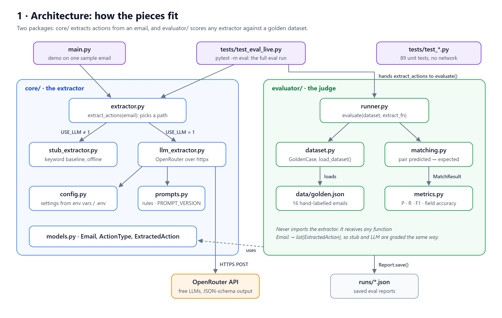
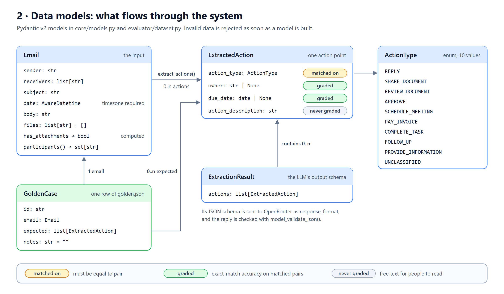
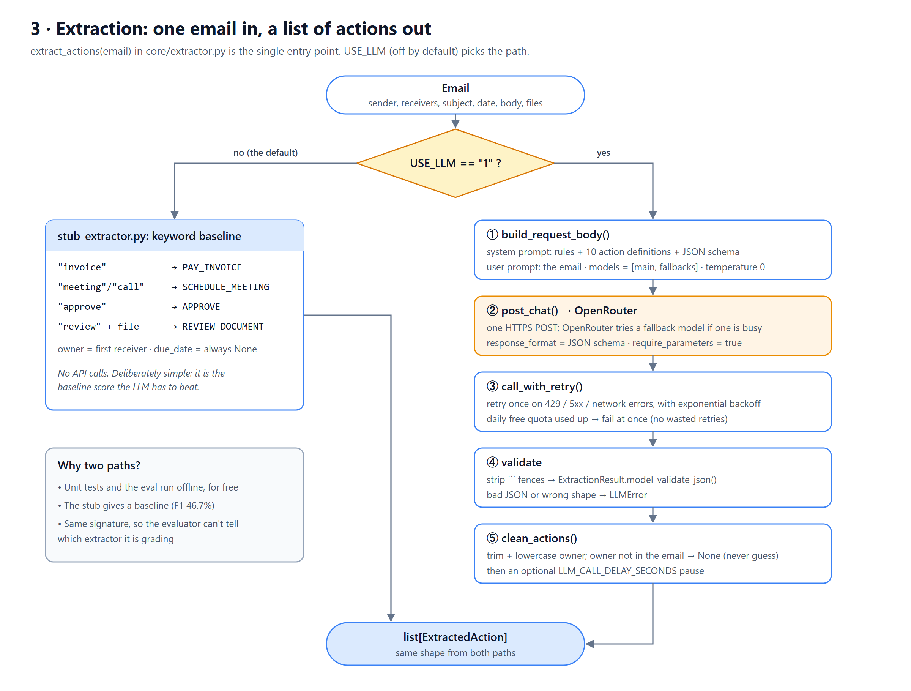
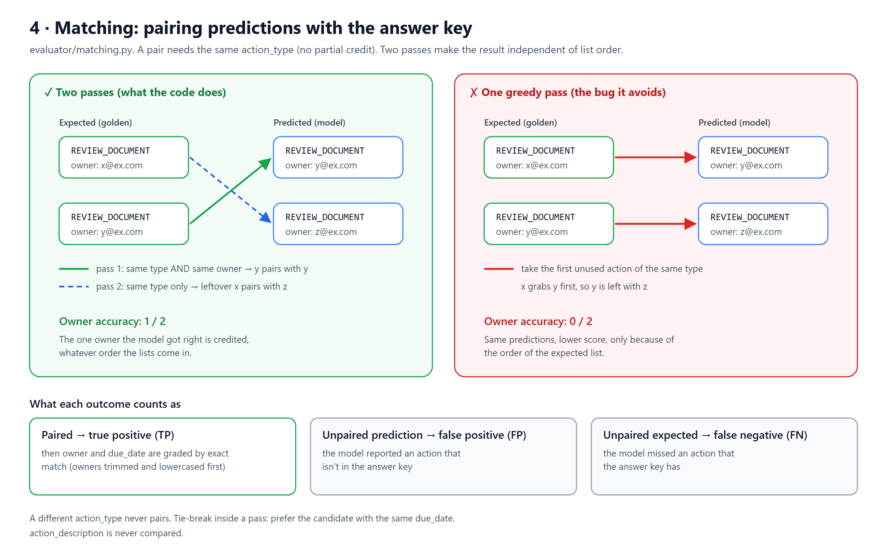
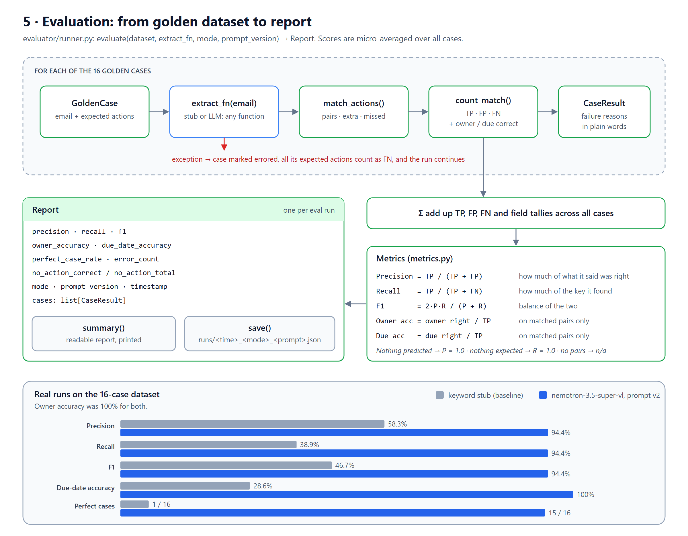

# Email Action Extractor + Evaluator

A small Python project that uses an LLM to pull **business actions** out of emails (reply,
review a document, schedule a meeting, pay an invoice, …) and, more importantly, an
**evaluator** that measures how well it does against a hand-labelled golden dataset.

The extractor is kept deliberately simple; the evaluator is the main point of the project.

## Results

Micro-averaged scores on the 16-case golden dataset:

| Extractor | Prompt | Precision | Recall | F1 | Owner acc. | Due-date acc. | Perfect cases |
|---|---|---|---|---|---|---|---|
| Keyword stub (baseline) | – | 58.3% | 38.9% | 46.7% | 100% | 28.6% | 1/16 |
| `nvidia/nemotron-3.5-super-vl:free` | v2 | 94.4% | 94.4% | 94.4% | 100% | 100% | 15/16 |

## How it works

```
Email ──► extract_actions() ──► list[ExtractedAction]
              │
              ├─ USE_LLM=1 → OpenRouter (plain httpx, JSON-schema structured output)
              └─ otherwise → offline keyword stub (no API calls)

golden.json ──► evaluate(dataset, extract_fn) ──► Report (P / R / F1, field accuracy, failures)
```

- **`core/`**: Pydantic models (`Email`, `ActionType`, `ExtractedAction`), the prompt, the
  LLM extractor and the offline stub. `extract_actions(email)` is the single entry point.
- **`evaluator/`**: dataset loading, two-pass action matching (type + owner, then type only,
  so list order doesn't matter), micro-averaged metrics, and a runner that produces a
  readable report and saves it as JSON. The evaluator never imports the extractor; it takes
  any `Email -> list[ExtractedAction]` function.
- Graded fields are `action_type` (for matching), `owner` and `due_date`.
  `action_description` is for people to read and is never graded.

## Diagrams

### Architecture


### Data models


### Extraction flow


### Matching


### Evaluation


SVG versions of each diagram are in [`docs/diagrams/`](docs/diagrams/).

## Setup

Requires Python 3.10+. Commands below are for Windows PowerShell.

```powershell
python -m venv .venv
.venv\Scripts\Activate.ps1
pip install -e ".[dev]"
Copy-Item .env.example .env
```

Then edit `.env`. To use the LLM, add a free key from <https://openrouter.ai/keys> and set
`USE_LLM=1`. With `USE_LLM` off (the default), everything runs offline against the stub.

| Variable | Meaning |
|---|---|
| `OPENROUTER_API_KEY` | Your OpenRouter key (never commit it; `.env` is git-ignored) |
| `USE_LLM` | `1` = call the LLM, anything else = offline stub |
| `LLM_MODEL` | Main model ID (default in `core/config.py`) |
| `LLM_FALLBACK_MODELS` | Comma-separated fallbacks, or `none` |
| `LLM_TIMEOUT_SECONDS` | Max seconds per response (default 60) |
| `LLM_CALL_DELAY_SECONDS` | Pause after each call, to stay under free-tier rate limits |

## Usage

```powershell
python main.py                          # extract actions from a sample email
pytest                                  # unit tests, no API calls
pytest -m eval -s                       # eval against the stub (baseline)
$env:USE_LLM="1"; pytest -m eval -s     # eval against the LLM
```

Eval reports are printed and saved to `runs/` (git-ignored), tagged with the mode/model and
prompt version.

## Project origin

`BUILD_PROMPT.md` contains the step-by-step spec this project was built from with Claude Code.

## License

[MIT](LICENSE)
